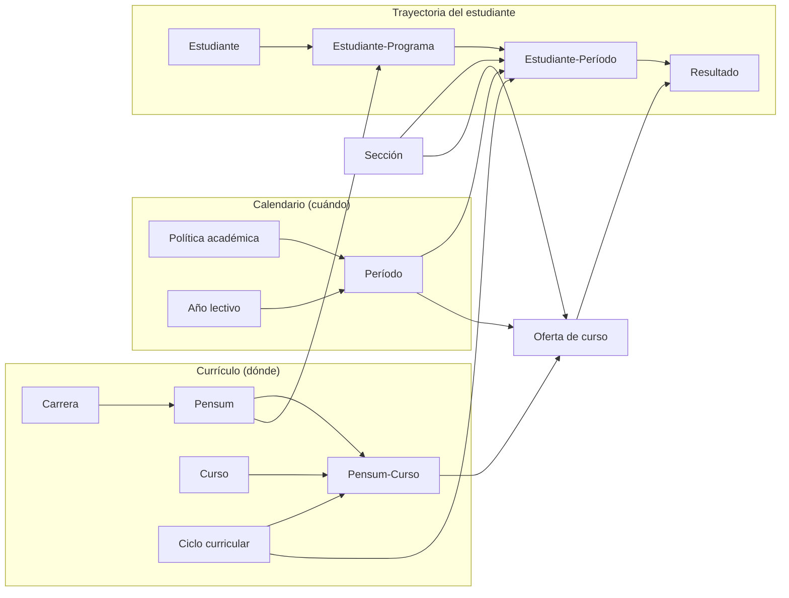
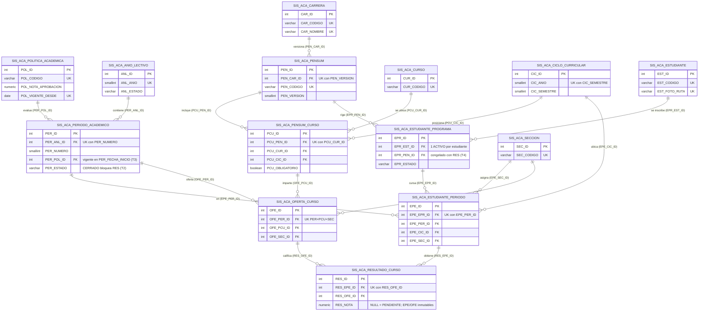

# Modelo ER — Sistema Académico (SIS_ACA)

Fuente: estructura E1 (`database/01_schema.sql` + `02_constraints.sql`). Todas las relaciones son 1:N obligatorias del lado hijo (FK `NOT NULL`, `ON DELETE RESTRICT`).

## 1. ER conceptual

Dos ejes que no se mezclan. El **currículo** responde *dónde va el curso en el pensum*; el **calendario** responde *cuándo se cursó*. Se cruzan en la oferta y en el resultado.

## 2. ER lógico (PK / FK / UK)

## 3. Reglas que el diagrama no muestra

| Regla | Dónde se garantiza |
|---|---|
| Carrera del estudiante = carrera del pensum | Por construcción: no existe columna de carrera en EPR (H1) |
| Resultado: mismo período, mismo pensum, misma sección | T2 (SA201–SA203) |
| Resultados mutables solo con período ABIERTO, estudiante INSCRITO y oferta activa (INSERT/UPDATE/DELETE) | T2 (SA204, SA205, SA206) |
| Sin nuevo intento de un curso ya aprobado en un período anterior | T2 (SA207) |
| Período usa la política vigente en su inicio; política usada inmutable | T3 (SA301–SA305) |
| Contexto académico congelado si hay dependencias (8 tablas: EPR, EPE, OFE, PCU, PEN, PER, ANL, CIC) e identidad de RES inmutable | T4 (SA401) |
| Estado APROBADO/REPROBADO/PENDIENTE | Derivado en vistas, nunca almacenado |
