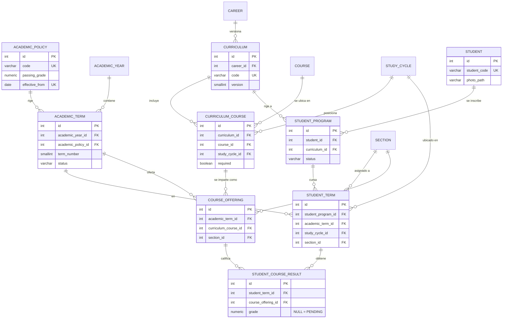

# FASE 1 — Auditoría del requerimiento
**Sistema Académico Symfony · Capa PostgreSQL**
Fuente: `Arquitectura SQL.md` (contrato maestro) + `ProyectoFinalB.pdf` (enunciado UMG, entrega 16/10/2026)

> STATUS: **NEEDS REVIEW** — no se genera DDL hasta aprobar la sección 9.

---

## 1. Evaluación del modelo propuesto

El modelo del contrato es sólido y cubre de sobra el enunciado del PDF (alumno, carrera, semestre, sección, curso, nota y los tres reportes). Separa correctamente currículo (`study_cycle`, `curriculum_course`) de calendario (`academic_year`, `academic_term`), versiona pensum y política, y evita almacenar APPROVED/FAILED.

Encontré **4 hallazgos de diseño** que conviene corregir antes del DDL (detalle en §9) y **3 ambigüedades** con suposición adoptada (§8). Ninguna es bloqueante.

| Aspecto | Evaluación |
|---|---|
| Cobertura del PDF | PASS — todo requerimiento del enunciado tiene tabla/vista. |
| Separación currículo vs calendario | PASS |
| Versionamiento de política | PASS con hallazgo H2 (`effective_to` / `active` redundantes). |
| Normalización | WARNING — `student_program.career_id` es derivable (H1). |
| Integridad transversal | WARNING — reglas 3, 4 y 5 de §17 requieren trigger; además hay riesgo de mutación "aguas arriba" (H3). |
| Doctrine | PASS con advertencia: constraints compuestas, índices parciales y vistas no las genera Doctrine (H4). |
| Alcance vs plazo | WARNING — 9 fases para entregar el 16/10. Propuesta de compresión en §9. |

---

## 2. Entidades definitivas propuestas (14 tablas)

| # | Tabla | Propósito | Cambio vs contrato |
|---|---|---|---|
| 1 | `academic_policy` | Reglas académicas versionadas (nota mínima). | Sin `effective_to` ni `active` almacenados (H2). |
| 2 | `academic_year` | Año lectivo. | `year` → `year_number` (evita palabra clave SQL). |
| 3 | `academic_term` | Período real (2026-I). Apunta a su política. | — |
| 4 | `career` | Catálogo de carreras. | — |
| 5 | `curriculum` | Pensum versionado por carrera. | `version SMALLINT`, `UNIQUE(career_id, version)`. |
| 6 | `study_cycle` | Posición curricular (Año 1 / Sem I). Catálogo global. | `sort_order` eliminado: se ordena por `(year_number, term_number)`. |
| 7 | `course` | Catálogo maestro de cursos. | — |
| 8 | `curriculum_course` | Curso dentro de un pensum y ciclo. | Sin créditos/horas/área (no aportan a ningún reporte requerido). `elective` = `NOT required`. |
| 9 | `section` | Catálogo A, B, C. | — |
| 10 | `student` | Datos personales + `photo_path`. | — |
| 11 | `student_program` | Estudiante ↔ pensum (trazabilidad). | **Sin `career_id`** (H1). |
| 12 | `student_term` | Ciclo y sección del estudiante en un período. | — |
| 13 | `course_offering` | Curso del pensum ofertado en período + sección. | — |
| 14 | `student_course_result` | Inscripción/intento + nota (NULL = pendiente). | Se documenta que **una fila = un intento**. |

Convenciones: singular, snake_case, PK `id INTEGER GENERATED BY DEFAULT AS IDENTITY` (BY DEFAULT y no ALWAYS: es lo que Doctrine DBAL 4 genera y permite seeds sin `OVERRIDING SYSTEM VALUE`; INTEGER sobra para el volumen de una escuela y mapea a `int` sin ambigüedad). Estados como `VARCHAR(20) + CHECK` (no ENUM: agregar un valor es un `ALTER ... CHECK` transaccional y Doctrine lo mapea a un *backed enum* de PHP sin tipos personalizados).

---

## 3. Relaciones y cardinalidades

| Relación | Card. | Doctrine (futuro) | ON DELETE |
|---|---|---|---|
| academic_year → academic_term | 1:N | Term ManyToOne Year | RESTRICT |
| academic_policy → academic_term | 1:N | Term ManyToOne Policy | RESTRICT |
| career → curriculum | 1:N | Curriculum ManyToOne Career | RESTRICT |
| curriculum → curriculum_course | 1:N | CurriculumCourse ManyToOne Curriculum | RESTRICT |
| course → curriculum_course | 1:N | CurriculumCourse ManyToOne Course | RESTRICT |
| study_cycle → curriculum_course | 1:N | CurriculumCourse ManyToOne StudyCycle | RESTRICT |
| student → student_program | 1:N | StudentProgram ManyToOne Student | RESTRICT |
| curriculum → student_program | 1:N | StudentProgram ManyToOne Curriculum | RESTRICT |
| student_program → student_term | 1:N | StudentTerm ManyToOne StudentProgram | RESTRICT |
| academic_term → student_term | 1:N | StudentTerm ManyToOne AcademicTerm | RESTRICT |
| study_cycle → student_term | 1:N | StudentTerm ManyToOne StudyCycle | RESTRICT |
| section → student_term | 1:N | StudentTerm ManyToOne Section | RESTRICT |
| academic_term → course_offering | 1:N | Offering ManyToOne AcademicTerm | RESTRICT |
| curriculum_course → course_offering | 1:N | Offering ManyToOne CurriculumCourse | RESTRICT |
| section → course_offering | 1:N | Offering ManyToOne Section | RESTRICT |
| student_term → student_course_result | 1:N | Result ManyToOne StudentTerm | RESTRICT |
| course_offering → student_course_result | 1:N | Result ManyToOne CourseOffering | RESTRICT |

No hay ManyToMany "puras": toda relación N:M (`curriculum`↔`course`, `student`↔`curriculum`) lleva atributos, así que se modela como entidad intermedia. **Ningún `ON DELETE CASCADE`**: todo es histórico; los catálogos se desactivan con `active = false`.

---

## 4. Reglas protegibles con constraints declarativas

| Regla | Mecanismo |
|---|---|
| Nota válida 0–100 | `CHECK (grade IS NULL OR grade BETWEEN 0 AND 100)` |
| Nota mínima válida | `CHECK (passing_grade BETWEEN 0 AND 100)` |
| Nota y fecha de calificación coherentes | `CHECK ((grade IS NULL) = (graded_at IS NULL))` |
| Fechas no invertidas | `CHECK (start_date <= end_date)`, `CHECK (effective_to IS NULL OR effective_to >= effective_from)` |
| Códigos únicos | `UNIQUE(code)` en career, course, curriculum, section, academic_policy; `UNIQUE(student_code)` |
| Formato de código | `CHECK (student_code ~ '^STU-[0-9]{4}-[0-9]{4}$')` (idem cursos/carreras) |
| Sin períodos duplicados | `UNIQUE(academic_year_id, term_number)` |
| Sin ciclos duplicados | `UNIQUE(year_number, term_number)` en study_cycle |
| Curso una sola vez por pensum | `UNIQUE(curriculum_id, course_id)` en curriculum_course |
| Orden dentro del ciclo | `UNIQUE(curriculum_id, study_cycle_id, sequence_order)` |
| Pensum único por versión | `UNIQUE(career_id, version)` |
| Una sola política por fecha de inicio | `UNIQUE(effective_from)` |
| Un student_term por programa y período | `UNIQUE(student_program_id, academic_term_id)` |
| Oferta única | `UNIQUE(academic_term_id, curriculum_course_id, section_id)` |
| Un resultado por estudiante y oferta | `UNIQUE(student_term_id, course_offering_id)` |
| Un solo programa ACTIVO por estudiante | Índice único parcial `UNIQUE(student_id) WHERE status = 'ACTIVE'` |
| Pensum ↔ carrera coherente (§17.1) | **Desaparece por diseño** (H1): la carrera se obtiene del pensum. |
| Estados válidos | `CHECK (status IN (...))` |
| Sin huérfanos | FK + NOT NULL |
| Fotografía no binaria | `photo_path VARCHAR(255)`; no existe columna BYTEA |

---

## 5. Reglas que requieren trigger o capa de aplicación

### Triggers propuestos (4 funciones, cada una con una responsabilidad)

| ID | Función | Tablas | Responsabilidad | Por qué no basta un constraint |
|---|---|---|---|---|
| T1 | `fn_set_updated_at()` | todas las que tienen `updated_at` | Sellar `updated_at` en UPDATE. | DEFAULT solo aplica en INSERT. Garantiza el dato aunque se escriba por SQL directo (seeds, psql), no solo vía Doctrine. |
| T2 | `fn_validate_result_context()` | student_course_result (BEFORE INSERT/UPDATE) | Un resultado solo es válido si: (a) `student_term.academic_term_id = course_offering.academic_term_id`; (b) el pensum de la oferta = pensum del `student_program`; (c) misma sección; (d) el período no está CLOSED. | Son comparaciones a 2–3 saltos de distancia; un CHECK no puede ver otras tablas. |
| T3 | `fn_protect_used_policy()` | academic_policy (UPDATE/INSERT), academic_term (UPDATE de `academic_policy_id`) | Impedir reforma retroactiva: no cambiar `passing_grade`/`effective_from` de una política ya usada por un período; no reasignar la política de un período con notas registradas; no insertar una política con vigencia anterior a una ya utilizada. | La FK protege la existencia, no la inmutabilidad del valor. |
| T4 | `fn_freeze_result_context()` | student_program, student_term, course_offering (BEFORE UPDATE) | Si ya existen resultados, impedir cambiar columnas de contexto (`curriculum_id`, `academic_term_id`, `section_id`, `curriculum_course_id`, `student_program_id`). | Sin esto, T2 se puede burlar editando la tabla padre después de registrar la nota (H3). |

Cada trigger tendrá mensaje legible (`RAISE EXCEPTION ... USING ERRCODE, HINT`) y prueba positiva y negativa.

**Decisión §3 (política histórica):** combinación de mecanismos. La FK explícita `academic_term.academic_policy_id` fija qué regla evalúa cada período (no se resuelve "por fecha" en cada consulta, lo que sería frágil si alguien corrige fechas); T3 congela la política una vez usada. Así la prueba §47 (POL-2028 = 70 no convierte en FAILED el 65 de 2026) se cumple estructuralmente.

### Capa de aplicación (Symfony) + consultas de diagnóstico

- Sugerir la política vigente al crear un período (la BD valida coherencia con un diagnóstico, no la impone).
- Transiciones de estado PLANNED → OPEN → CLOSED.
- No ofrecer catálogos `active = false` en formularios.
- Gestión física de la foto (subida, nombre, borrado).
- Generación del `student_code` (o secuencia; ver §8).
- Diagnósticos (archivo 10): fechas de período fuera del año, períodos solapados, período fuera de la vigencia de su política, `study_cycle` de student_term no usado por el pensum, programa COMPLETED con avance < 100 %, ofertas sin alumnos, ciclos sin cursos.

---

## 6. Riesgos y puntos ciegos

| # | Riesgo | Mitigación |
|---|---|---|
| R1 | **Granularidad de las vistas de progreso.** El contrato pide progreso "por estudiante", pero un estudiante puede tener más de un `student_program` en su historia. Agrupar por estudiante mezclaría pensums. | Grano = `student_program`. Las vistas incluyen `student_program_id`. |
| R2 | **Repitencia ≠ ciclo actual.** Quien repite Programación I (ciclo 1) en 2026-I estando en ciclo 3 genera un resultado cuyo ciclo de curso ≠ ciclo del student_term. | No se valida igualdad de ciclo (sería un falso error). Sí se valida pensum, período y sección. |
| R3 | **Sección estricta vs repitencia.** Si se exige misma sección (T2-c), un repitente solo puede llevar el curso si existe oferta en su sección. | Suposición S1 (§8). |
| R4 | **NULL como falso aprobado.** | `CASE` evalúa `grade IS NULL` primero; tasas de aprobación excluyen pendientes del denominador; promedios ignoran NULL (comportamiento estándar de AVG). |
| R5 | **Doble conteo de aprobados.** | Progreso cuenta `DISTINCT curriculum_course_id` con al menos un intento aprobado; solo cursos `required`. Imposible > 100 % (y hay diagnóstico). |
| R6 | **Una inscripción "duplicada" en otra sección del mismo período.** | Con sección estricta + oferta única por (período, curso, sección), un student_term solo puede casar con una oferta por curso por período. La unicidad se cumple de forma transitiva. |
| R7 | **Cambio de pensum del estudiante** (2026 → 2028): no hay tabla de equivalencias, el avance arranca en 0. | Limitación documentada; fuera de alcance. |
| R8 | **Pruebas dependientes de la fecha actual.** `vw_current_academic_policy` usa `CURRENT_DATE`; el resultado cambia en 2028. | Las pruebas usan `vw_academic_policy_timeline` con fecha literal. |
| R9 | **Notas con decimales** (60.5): con la regla literal es FAILED. | Suposición S2 (§8). |
| R10 | **Doctrine "repara" el esquema.** `doctrine:schema:update` intentaría borrar CHECKs, índices parciales y vistas que no conoce. | BD como fuente de verdad: migraciones escritas en SQL, `schema_filter` para excluir vistas; las vistas se mapean como entidades `readOnly` con clave estable o se consultan por DBAL. |
| R11 | **CHECK con `CURRENT_DATE`** (p. ej. `birth_date <= CURRENT_DATE`) no se revalida y no es inmutable. | CHECK con límite fijo (`birth_date >= '1990-01-01'`) + validación de edad en Symfony. |

---

## 7. Propuesta ER preliminar



Estado del resultado (derivado, nunca almacenado):

```
grade IS NULL                                   → PENDING
grade >= policy.passing_grade (del período)     → APPROVED
grade <  policy.passing_grade (del período)     → FAILED
```

Intentos (derivados): `ROW_NUMBER() OVER (PARTITION BY student_program_id, curriculum_course_id ORDER BY term.start_date)`. No se almacena `attempt_number`: con la cadena resultado → oferta → período el orden es determinista, y guardarlo crearía una segunda verdad que se desincroniza si se corrige un intento antiguo.

---

## 8. Preguntas bloqueantes

**Ninguna bloquea.** Adopto estas suposiciones; corrígeme si no aplican:

| ID | Ambigüedad | Suposición adoptada | Alternativa |
|---|---|---|---|
| S1 | ¿La sección de la oferta debe ser la misma del estudiante en ese período? | **Sí (estricta).** Reportes por sección sin ambigüedad; previene doble inscripción (R6). | Permitir otra sección solo para repitentes (requiere UNIQUE adicional vía trigger). |
| S2 | ¿Las notas llevan decimales y se redondean? | `NUMERIC(5,2)`, **sin redondeo**: 60.50 es FAILED. | `NUMERIC(5,0)` (enteros), habitual en bachillerato guatemalteco; elimina el caso. |
| S3 | ¿Se pueden modificar notas de un período CLOSED? | **No** (T2-d). Para corregir, se reabre el período (acción explícita). | Permitir edición con bitácora (más complejo; fuera de alcance). |
| S4 | Versión de PostgreSQL | Objetivo: la que trae Ubuntu 26.04 (verificar con `psql --version`); el script se limita a sintaxis compatible con PG 16+. | — |
| S5 | `student_code` | Lo genera la aplicación con formato `STU-AAAA-NNNN`; la BD valida formato y unicidad. | Secuencia por año en BD (más lógica en SQL). |

---

## 9. Cambios recomendados antes del DDL (requieren aprobación)

### H1 — Eliminar `student_program.career_id`
- **Problema:** la carrera es función del pensum (`curriculum.career_id`). Almacenarla otra vez es dependencia transitiva (viola 3FN) y es justamente lo que permite la inconsistencia de §12.
- **Impacto:** con la columna hay que añadir FK compuesta o trigger para impedir "Carrera A + pensum de Carrera B".
- **Recomendación:** quitarla. La inconsistencia se vuelve **imposible por construcción**. "Alumnos por carrera" requiere un JOIN extra a `curriculum` (indexado, costo despreciable).
- **Migración:** `student_program` pierde una columna; Doctrine: `StudentProgram → Curriculum → Career`. La prueba negativa "curriculum asignado a carrera incorrecta" se sustituye por una prueba que demuestra que el caso no se puede expresar.

### H2 — Política: derivar `effective_to` y eliminar `active`
- **Problema:** `active` + rango de fechas son dos fuentes de verdad ("activa" pero vencida). Y `effective_to` almacenado exige un trigger anti-solapamiento, porque `EXCLUDE` necesita `btree_gist` (extensión prohibida por §18).
- **Recomendación:** las políticas son una sucesión continua: `effective_to = LEAD(effective_from) - 1` en `vw_academic_policy_timeline`. Con `UNIQUE(effective_from)` no puede haber solapamientos ni huecos. Se ahorra un trigger.
- **Alternativa:** conservar ambas columnas + trigger T5 anti-solapamiento.
- **Migración:** `academic_policy` pierde 2 columnas; se gana 1 vista.
- *(En `curriculum` sí conservo `effective_to`: significa "último día para admitir estudiantes" y dos pensums pueden coexistir durante una transición.)*

### H3 — Congelar el contexto una vez existen notas (T4)
- **Problema:** validar coherencia solo al insertar la nota no basta; luego se puede cambiar `student_term.section_id` o `course_offering.academic_term_id` y dejar la nota en un contexto inválido.
- **Recomendación:** T4 bloquea esos UPDATE cuando hay resultados dependientes. Corregir = borrar y recrear antes de calificar.

### H4 — La BD es la fuente de verdad, no Doctrine
- Doctrine se configura en modo *database-first*: no usar `schema:update`; `schema_filter: ~^(?!vw_)~`; vistas como entidades `readOnly` (`vw_student_grade_entry` tendrá clave compuesta estable `student_term_id + curriculum_course_id`).

### Ajustes menores
- `academic_year.year` → `year_number`; `study_cycle.sort_order` eliminado (derivable).
- **Estructura de archivos:** acepto la división de §36 con 3 añadidos: `13_positive_tests.sql` (§32 no tiene archivo asignado), `14_explain.sql` (§35) y `run_all.sql` (orquesta con `\set ON_ERROR_STOP on`). Documentación en `docs/` (`data_dictionary.md`, `traceability_matrix.md`, `er_model.md`). `00_reset.sql` aborta si `current_database()` no es `sistema_academico_dev`.
- **Pruebas sin pgTAP:** bloques `DO` que capturan el `SQLSTATE` esperado y emiten `PASS`/`FAIL`, dentro de transacciones con `ROLLBACK`.
- **Seeds reproducibles:** inserts que resuelven IDs por código natural (`SELECT id FROM course WHERE code = 'PRG-101'`), nunca IDs fijos ni `random()`.

### Propuesta de calendario (entrega 16/10, 12 días)
Las fases 2–9 son mucho para el plazo, considerando que después falta Symfony + PDF. Propongo:

| Entrega | Contenido | Fases |
|---|---|---|
| E1 | Diccionario + DDL + constraints + índices + triggers + vistas | 2, 3, 4 |
| E2 | Dataset (casos A–J) + 25 consultas | 5, 6 |
| E3 | Pruebas +/−, EXPLAIN, self-audit, README, matriz, paquete | 7, 8, 9 |

---

**NEXT:** aprobar H1, H2, H3 y S1–S3 (o indicar cambios). Con eso arranco E1.
